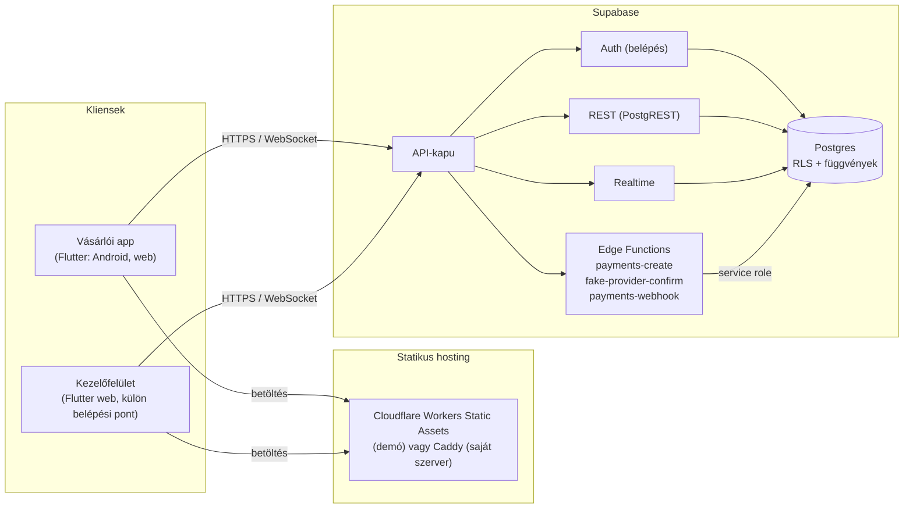

# Architektúra

Ez a lap azt írja le, **hogyan van összerakva** a Zaba, és mely szabályokat érdemes tartani, hogy a demóból bővítéssel (nem újraírással) lehessen MVP.
A részletek külön lapokon vannak: az adatbázis [`data-model.md`](data-model.md), a fizetés [`payment-flow.md`](payment-flow.md), a döntések és mérések
[`decisions.md`](decisions.md), a környezeti változók [`env-vars.md`](env-vars.md), **az egész kódbázis részletes leírása** a [`development.md`](development.md)-ben, az éles üzem terve a [`real-life-plan.md`](real-life-plan.md)-ben.

## Áttekintés



A két kliens **ugyanabból a Flutter projektből** épül (`app/`): a `lib/main.dart` a vásárlói app, a `lib/main_admin.dart` a kezelőfelület. Mivel külön belépési pontok,
a vásárlói buildbe az admin kódja (és a feliratai) nem kerül be. A backend egyetlen Supabase projekt; a rendszernek nincs más szervere.

## A három szereplő

| Szereplő | Mit tehet | Hogyan |
|---|---|---|
| **Vásárló** (appban vagy weben) | böngészik, kosarat tölt, rendel, fizet, követi és lemondja a rendelését | Supabase Auth belépés; olvasás RLS-sel a saját soraira; írás **csak a függvényeken át** |
| **Munkatárs** (`admin` vagy `operator`) | látja az összes rendelést, léptet az állapotgépen, lemond; az `admin` az audit naplót is látja | belépés + az `admin_users` tábla; `admin_set_order_status` |
| **Fizetési szolgáltató** | aláírt eseményt küld a fizetésről | a `payments-webhook` fogadja; **csak ez teheti a rendelést kifizetetté** |

## A kliens felépítése (`app/lib`)

```
core/        közös alap: téma, pénz (Money), útvonalak (go_router), Supabase indítás, Realtime, konfiguráció, közös elemek
features/    egy mappa funkciónként: auth, catalog, cart, delivery, checkout, payment, orders, notifications, profile, admin
  <funkció>/
    domain/        tiszta Dart: modellek, szabályok, az adatforrás interfésze (repository)
    data/          az interfész megvalósítása: Supabase és memóriabeli
    application/   Riverpod provider-ek: állapot, a repository-k és a UI között
    presentation/  képernyők és elemek
l10n/        a magyar szövegek (ARB), a kód nem tartalmaz beégetett feliratot
```

A függőség iránya: **képernyő → provider → repository (interfész) → adatforrás**. Ebből két dolog következik:

- **A memóriabeli megvalósítások** (`InMemory…`) nem csak tesztdublőrök: konfiguráció (`SUPABASE_URL`) nélkül az app ezeken fut, backend nélkül, egy beépített demó fiókkal. A `main.dart`
  csak annyit tesz, hogy backend esetén a Supabase megvalósításokra cseréli a providereket (`overrideWith`); a képernyők nem tudnak a különbségről.
- **Az MVP-ben egy adatforrás cseréje** (például más belépés vagy más fizetési szolgáltató) egy új megvalósítás az interfész mögött, a képernyők érintése nélkül.

Pár szabály, ami a kódban végig érvényes:

- **A pénz `Money`** (egész forint, bruttó); soha nem lebegőpontos. A kliens **soha nem számol hitelesen**: a végösszeget a szerver adja (`quote_cart`), az app a kosárban és a pénztárban az ő válaszát mutatja.
- **Az állapotgép a szerveren van.** A kliens csak címkéket és idővonalat mutat, átmenetlogikája nincs.
- **Élő frissítés** (`core/realtime/live_query.dart`): a Realtime jelez változást, az érték újra lekérdeződik; amíg a kapcsolat nem él, 5 mp-enként lekérdez, és percenként akkor is frissít,
  továbbá a kapcsolat felépülése után 2 mp-cel még egyszer (a Realtime kicsivel azelőtt jelzi késznek magát, hogy tényleg kézbesítene). A Realtime a sor szintű jogosultságot is érvényesíti.
- **A navigáció** `go_router`: a belépést igénylő útvonalakat (pénztár, fizetés, rendelések) a router vendég esetén a belépésre irányítja, és megjegyzi, hová tartott.
- **Az értesítések** a `NotificationSender` interfész mögött vannak; a demóban az `InAppNotifier` (sáv az app tetején, lista), a rendelés állapotváltásaiból. Valódi push az MVP-ben ugyanezen interfész új megvalósítása.

## A backend (`supabase/`)

- **Séma:** `migrations/` (12 migráció, időrendben), kiinduló adatok `seed/`. A séma az MVP részhalmaza, nem eldobható változat ([`data-model.md`](data-model.md)).
- **Jogosultság alapból zárva.** Minden táblán RLS, és a táblákra a kliens szerepeinek nincs írási joga: **az állapotot csak biztonságos (`security definer`) függvények
  változtatják**, bemenet-ellenőrzéssel. A függvények: `quote_cart`, `get_delivery_slots`, `place_order`, `start_payment`, `cancel_order`, `admin_set_order_status`, `apply_payment_event`.
  A segédek a `private` sémában vannak (nem hívhatók a kliensről): állapotgép-lépés, ÁFA-számítás, idősáv-generálás, árazás, szerepkör-ellenőrzés.
- **Az állapotgép egyetlen táblában** (`order_status_transitions`), ezt a `private.transition_order` olvassa; a Dart oldalon nincs átmenetlogika.
- **Idempotencia:** a rendelés leadása felhasználónként egyedi kulccsal, a fizetési esemény egyedi szolgáltatói azonosítóval; a kétszer küldött kérés egyszeres hatású.
- **Edge Functions** (`functions/`, Deno, TypeScript): a fizetés három lépése. A fizetési szolgáltató egy **interfész mögött** áll (`_shared/payments/provider.ts`), a szimulált megvalósítás a
  `fake_provider.ts`; az MVP-ben a valódi szolgáltató adaptere kerül a helyére, a három függvény és az adatbázis érintetlen marad.
- **Tesztek:** pgTAP (`tests/database/`, a séma, a jogosultság, az árazás, az idősávok, a rendelés- és fizetési függvények, a regisztráció), HTTP-s smoke tesztek (`tests/*.py`) a futó stack ellen,
  és Node-tesztek a fizetési kódra (`npm run test:functions`).

## A fő út: rendelés és fizetés

A teljes sorozat a [`payment-flow.md`](payment-flow.md)-ben van (diagrammal). Röviden: `place_order` (rendelés `pending_payment`) → `payments-create` (fizetési munkamenet) → a kártyaűrlap
(a kártyaszám **csak az appban marad**, a szervernek a kimenet megy) → `fake-provider-confirm` (a „szolgáltató háttere": aláírt esemény) → `payments-webhook` (aláírás-ellenőrzés) → `apply_payment_event`
(csak ez viheti `received`-be). A vásárló az állapotot Realtime-on át látja.

## Környezetek

| Környezet | Hol fut | Mire | Leírás |
|---|---|---|---|
| `dev` | a fejlesztő gépén (`npx supabase start`, Docker) | napi fejlesztés, tesztek | [`README.md`](../README.md) |
| `staging` | saját szerver: a hivatalos Supabase self-host csomag + Caddy, Cloudflare Tunnellel | köztes állapot telefonról | [`deploy/selfhost/README.md`](../deploy/selfhost/README.md) |
| `demo` | Cloudflare Workers Static Assets (3 oldal) + Supabase Free | a megrendelőnek adott link | [`demo-environment.md`](demo-environment.md) |

Minden környezet **ugyanazokból a fájlokból** áll össze (`migrations`, `seed`, `functions`); a kliens a címét és a publikus kulcsát buildkor kapja a `config/<env>.json`-ból. Ezért az átültetés
az egyik környezetből a másikba (vagy a megrendelő saját fiókjaiba) telepítés, nem átírás.

## Minőségbiztosítás (CI)

A `ci.yml` négy feladata minden egyesítendő változtatáson fut: az **app** (formázás, elemzés, tesztek, a demó webes build ellenőrzéssel), az **adatbázis** (migrációk, pgTAP, lint, a három smoke teszt, a függvények Node-tesztjei, és az app integrációs tesztjei a valódi, futó stack ellen),
a **telepítő fájlok** (shellcheck, Caddyfile) és a **titokkeresés** a teljes történeten (gitleaks). Mind a négy lokálisan is lejátszható; a telepítő workflow-k kézzel indíthatók.
(Jelenleg a CI a `main` ágra és a pull request-ekre fut, a fejlesztői ágak pusholására nem.)

## Hol bővítsd az MVP-hez

| Cél | Hol kell nyúlni | Mi marad érintetlen |
|---|---|---|
| Éles fizetési szolgáltató | új adapter a `_shared/payments/` alatt (a `PaymentProvider` interfész mögé); a webhook és a kártyalépés a szolgáltató saját folyamatára cserélődik | adatbázis, `apply_payment_event`, a kliens állapotkövetése |
| Valódi push értesítés | új `NotificationSender` megvalósítás (és `push_tokens` migráció) | az értesítések forrása (az állapotváltások) |
| Számlázás | új `invoices` migráció és egy számlázó adapter (a kód ma **nincs**, csak a hely) | a rendelés és a fizetés |
| Tényleges visszatérítés | `refunds` migráció és a szolgáltató felé hívás a lemondásnál (ma a státusz azonnal `refunded`) | az állapotgép |
| Készletfoglalás | az `inventory` táblán a `place_order`-ben | az árazás, a kliens |
| Saját képek, admin feltöltés | Supabase Storage; a `products.image_path` abszolút URL-t is bír | a katalógus-lekérdezés |
| Több munkatárs-szerep, felhasználókezelő felület | az `admin_users` táblára épülő képernyők (ma csak parancssori eszköz) | a jogosultságok az adatbázisban |
| Fiók törlése | anonimizáló függvény (a `orders.user_id` ma `on delete restrict`: a rendelésnek túl kell élnie a fiók takarítását, a könyvelés miatt) | a rendelések |

A teljes hiánylista az [ismert hiányok](known-gaps.md) lapon van.
