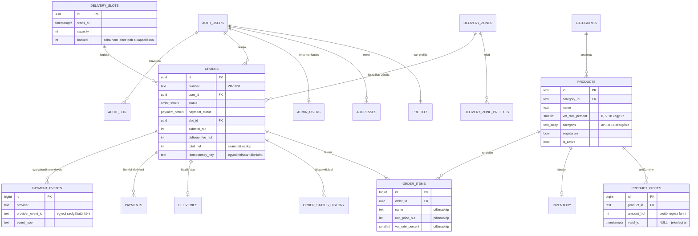
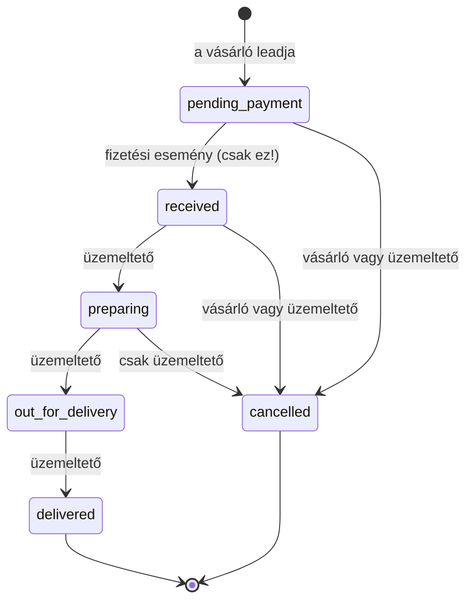

# Adatmodell

A séma a `supabase/migrations/` mappában van; az adatok és a tesztek mellette (`supabase/seed/`, `supabase/tests/`).
Ez a demó az MVP-séma **részhalmaza**, nem eldobható változat: az MVP-ben bővül (lásd a lap alján).

## ER-diagram

## A rendelés állapotgépe

Egyetlen helyen él: az `order_status_transitions` táblában. A `private.transition_order` függvény kényszeríti ki, az app csak
címkéket és idővonalat jelenít meg. A tábla teljes tartalmát a `060_seed_and_state_machine.test.sql` rögzíti.

Lemondáskor a rendelés visszaadja a helyét az idősávban, a kifizetett összeg pedig `refunded` lesz (a demóban azonnal; az MVP-ben
a fizetési szolgáltatótól kell visszatérítést kérni).

## Ki mit írhat

Semmilyen állapotváltoztató adat nem írható közvetlenül a kliensről: a táblákhoz nincs írási jog, csak a függvényeken keresztül.

| Művelet | Függvény | Ki hívhatja |
|---|---|---|
| Kosár árazása | `quote_cart` | bárki (belépés nélkül is) |
| Szabad idősávok | `get_delivery_slots` | bejelentkezett vásárló |
| Rendelés leadása (idempotens) | `place_order` | bejelentkezett vásárló |
| Fizetési kísérlet indítása | `start_payment` | a rendelés tulajdonosa |
| Rendelés lemondása | `cancel_order` | a rendelés tulajdonosa, amíg az állapotgép engedi |
| Állapot léptetése | `admin_set_order_status` | munkatárs (`admin`, `operator`), naplózva |
| Fizetési esemény feldolgozása (idempotens, csak nyitott és egyező fizetési kísérletre) | `apply_payment_event` | **csak a service role** (webhook-kezelő), lásd [`payment-flow.md`](payment-flow.md) |

Olvasás: a katalógus és a szállítási feltételek nyilvánosak; a vásárló csak a saját profilját, címeit és rendeléseit látja (a
rendelés idősávjának idejét is, a kapacitását nem); a munkatárs minden rendelést; az audit naplót csak az `admin` szerepkör. Minden tábla RLS-sel védett, és a jogosultságok alapból zártak.

## Pénz és idő

- Minden összeg egész forint (`integer`), bruttó. Soha nem lebegőpontos.
- Az ÁFA-kerekítés szabálya egyetlen függvényben van (`private.vat_from_gross`, felfelé kerekítés .5-nél). **Melyik ételre melyik
  ÁFA-kulcs vonatkozik, azt könyvelővel kell egyeztetni**; a demó adatai illusztratívak (minden termék 27 %).
- Az idők UTC-ben (`timestamptz`) tárolódnak. Az idősávokat a bolt időzónájában (`Europe/Budapest`) rakja ki a függvény, így a
  nyári időszámítás váltása helyesen jelenik meg UTC-ben (a `030_slots.test.sql` mindkét váltást teszteli).

## Ami az MVP-ben jön (külön migrációkban)

`carts`, `cart_items` (a demó kosara kliensoldali, de minden változásnál a szerver árazza), `refunds` (valódi visszatérítés a
szolgáltatón át), `invoices` (NAV Online Számla), `push_tokens`, készletfoglalás a `inventory` táblán, szolgáltatóhoz kötött
fizetési munkamenet lejárata, fiók törlése (a rendelések anonimizálása).
